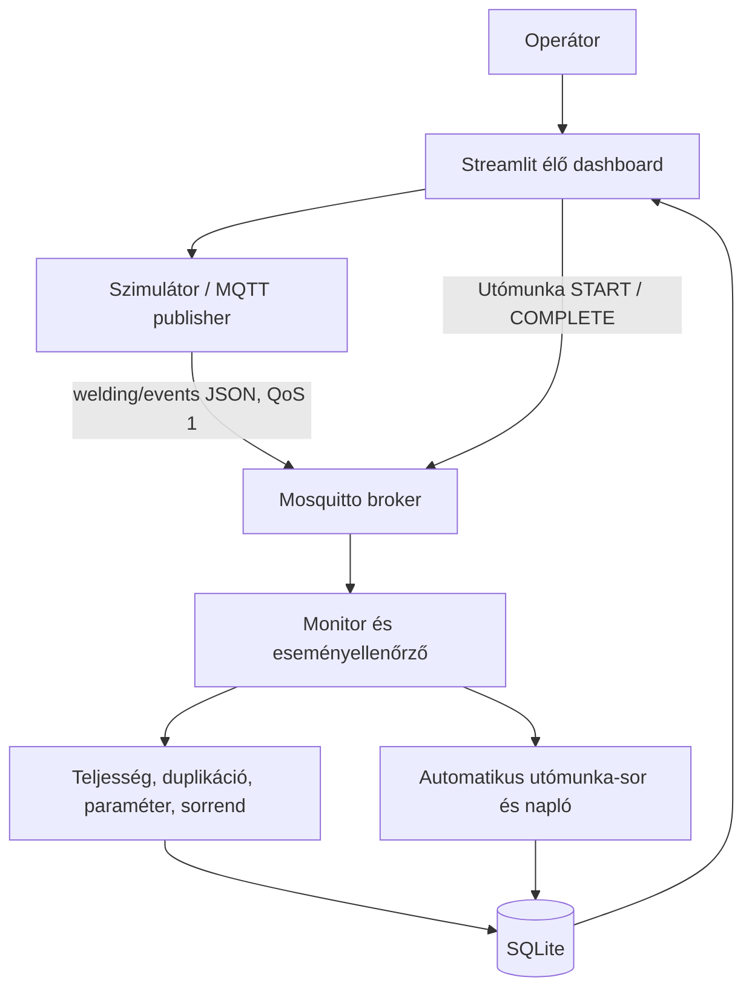

# Rendszerarchitektúra és ellenőrzési terv

## Cél és rendszerhatár

A rendszer egy szoftveresen szimulált autóipari ponthegesztési folyamatot modellez. A rendszerhatár a karosszéria indításától a pontonkénti MQTT-adatközvetítésen, az automatikus ellenőrzésen és a selejt utómunka-sorba helyezésén át az operátori dashboardig tart. Valódi hegesztőrobot, szenzor vagy Audi-gyártási adat nem része a megoldásnak.

## CPS-komponensek és szerepek

- **Fizikai folyamat modellje:** a karosszéria és a hozzá tartozó hegesztési pontok szimulációja.
- **Logikai komponensek:** szimulátor/publisher, MQTT-broker, monitor/ellenőrző, SQLite-adattár és Streamlit dashboard.
- **Transzducer/szenzor szerepének szimulációja:** a szimulátor generálja az áramerősség, hegesztési idő és elektródaerő értékeit.
- **Emberi szerep:** az operátor elindítja a szimulációt, figyeli a ponttérképet, megtekinti a hibákat, és az utómunka-soron kezeli a selejtes karosszériákat.

## Architektúra és adatfolyam



## MQTT eseménytípusok

- `body_start`: karosszériaazonosító, típus és az elvárt hegesztési pontok listája. Ebből a felület már az első hegesztés előtt tudja, mely pontokat kell megfigyelni.
- `weld_result`: karosszériaazonosító, pontazonosító, három szimulált paraméter és időbélyeg.
- `body_complete`: az elvárt pontlista és a karosszéria lezárása.
- `rework_action`: kezelői `START` vagy `COMPLETE` művelet, megjegyzéssel. Ez is MQTT-n jut el a monitorhoz.

## Ellenőrzési és hibakezelési szabályok

1. Minden elvárt pontazonosítóhoz legalább egy hegesztési eseménynek kell érkeznie. A lezáráskor hiányzó pontok külön listába kerülnek.
2. Az ugyanazon karosszériához tartozó ismételt pontazonosító külön eseménysorként marad meg, duplikációként megjelenik, és a karosszéria nem felel meg.
3. A váratlan pontazonosítókat külön listázza a rendszer.
4. Az áramerősség, hegesztési idő és elektródaerő a konfigurált, kizárólag demonstrációs határokon belül kell legyen.
5. A hibás JSON, hiányzó azonosító és ismeretlen eseménytípus a `system_errors` táblába kerül; a dashboardon látható.
6. A nem megfelelő lezárt karosszéria automatikusan `SELEJT / UTÓMUNKÁRA KÜLDVE` állapotot kap, és egyedi karosszériaazonosítóval bekerül az utómunka-sorba.
7. Az utómunka `UTÓMUNKÁRA VÁR` → `UTÓMUNKA FOLYAMATBAN` → `UTÓMUNKA ELVÉGEZVE – ÚJRAELLENŐRZÉS SZÜKSÉGES` állapotokban követhető. A lezárás nem minősíti automatikusan megfelelővé a karosszériát.
8. A dashboard 2 másodpercenként frissül, és mutatja a kiválasztott aktuális karosszéria ponttérképét, legutóbbi paramétereit, történetét, feldolgozási hibáit és utómunkáját.
9. A monitor a lezáró esemény küldési időbélyege és fogadási ideje alapján késleltetést is rögzít. Ez lokális demonstrációs mérés, nem ipari hálózati minősítés.

## Tesztterv

| Azonosító | Bemenet | Elvárt eredmény |
|---|---|---|
| T01 | Minden pont jelen van, minden paraméter normális | MEGFELELŐ; nincs utómunka-eset |
| T02 | Egy pont eseménye hiányzik | Selejt; hiányzó ID listázva; automatikus utómunka |
| T03 | Áramerősség a felső határ felett | Paraméterhiba és automatikus utómunka |
| T04 | Ugyanaz a pontazonosító kétszer érkezik | Duplikáció jelzése; automatikus utómunka |
| T05 | Ismeretlen pontazonosító érkezik | Váratlan pont jelzése; selejt |
| T06 | Ismeretlen eseménytípus érkezik | Feldolgozási hibánapló frissül |
| T07 | Utómunka START, majd COMPLETE | Állapotátmenet és műveletnapló |
| T08 | Eltérő hibaarányú több szimuláció | Az eredmények a dashboardon összehasonlíthatók |

A tesztek futtatása:

```powershell
python -m unittest discover -s tests -v
```

## Feltételezések és korlátok

A paraméterhatárok demonstrációs értékek, nem gyártói előírások. A szimulált paraméterek ellenőrzése nem bizonyítja a valódi hegesztési kötés fizikai szilárdságát vagy minőségét. A folyamatban lévő állapotot a `body_start` esemény, a végleges ellenőrzést a `body_complete` esemény határolja. A mérés reprodukálhatóságához a karosszériatípus, hibaarány, tesztfutás és az alkalmazott verzió dokumentálandó.
