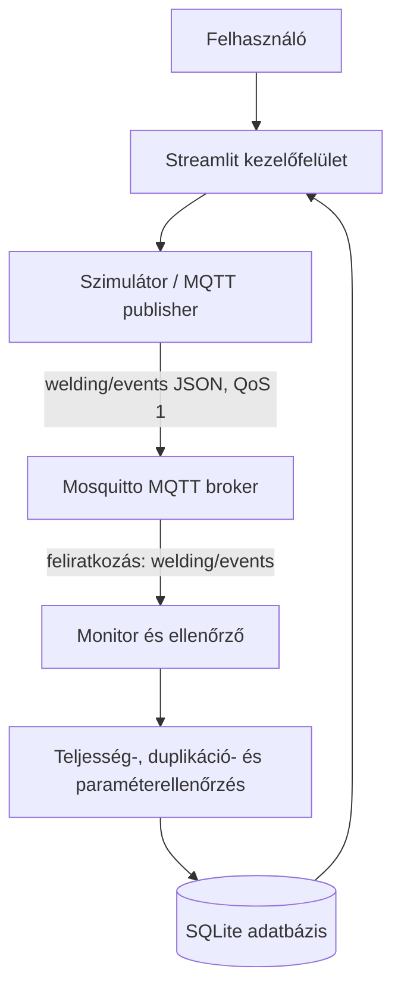

# Rendszerarchitektúra és ellenőrzési terv

## Cél és rendszerhatár

A rendszer egy szoftveresen szimulált autóipari ponthegesztési folyamatot modellez. A rendszerhatár a hegesztési események generálásától az MQTT-adatközvetítésen és az ellenőrzésen át az eredmények megjelenítéséig tart. Valódi hegesztőrobot, szenzor vagy Audi-gyártási adat nem része a megoldásnak.

## CPS-komponensek és szerepek

- **Fizikai folyamat modellje:** a karosszéria és a hozzá tartozó hegesztési pontok szimulációja.
- **Logikai komponensek:** publisher, MQTT-broker, subscriber/ellenőrző, SQLite-adattár és dashboard.
- **Transzducer/szenzor szerepének szimulációja:** a szimulátor generálja az áramerősség, hegesztési idő és elektródaerő értékeit.
- **Emberi szerep:** a felhasználó kiválasztja a karosszériatípust, beállítja a hibaarányt, elindítja a futást és áttekinti a jelzéseket.

## Architektúra és adatfolyam

## Üzenetmodell

A `weld_result` esemény tartalmazza a karosszériaazonosítót, karosszériatípust, hegesztési pont azonosítóját, a három szimulált paramétert és az esemény időbélyegét. A `body_complete` esemény tartalmazza az elvárt hegesztési pontok listáját, és lezárja az adott karosszéria futását.

## Ellenőrzési szabályok

1. Minden elvárt pontazonosítóhoz legalább egy eseménynek kell érkeznie.
2. A hiányzó vagy váratlan pontazonosítókat jelezni kell.
3. Az ismételt pontazonosítók duplikációként jelennek meg.
4. Az áramerősség, a hegesztési idő és az elektródaerő a programban megadott szimulációs határértékeken belül kell legyen.
5. Hiányzó pont, duplikáció vagy paraméterhiba esetén a karosszéria állapota `SELEJT / ELLENŐRIZENDŐ`.
6. A monitor a lezáró esemény küldési időbélyege és fogadási ideje alapján késleltetést is rögzít. Ez lokális demonstrációs mérés, nem ipari hálózati minősítés.

## Tesztterv

| Azonosító | Bemenet | Elvárt eredmény |
|---|---|---|
| T01 | Minden pont jelen van, minden paraméter normális | MEGFELELŐ |
| T02 | Egy pont eseménye hiányzik | SELEJT / ELLENŐRIZENDŐ; hiányzó ID listázva |
| T03 | Áramerősség a felső határ felett | Paraméterhiba jelzése |
| T04 | Ugyanaz a pontazonosító kétszer érkezik | Duplikáció jelzése |
| T05 | Ismeretlen pontazonosító érkezik | Váratlan pont jelzése |
| T06 | Különböző hibaarányokkal több futás készül | Eredmények összehasonlíthatók a dashboardon |

## Feltételezések és korlátok

A paraméterhatárok demonstrációs értékek, nem gyártói előírások. A szimulált paraméterek ellenőrzése nem bizonyítja a valódi hegesztési kötés fizikai szilárdságát vagy minőségét. A mérés reprodukálhatóságához a karosszériatípus, hibaarány, tesztfutás és az alkalmazott verzió dokumentálandó.
