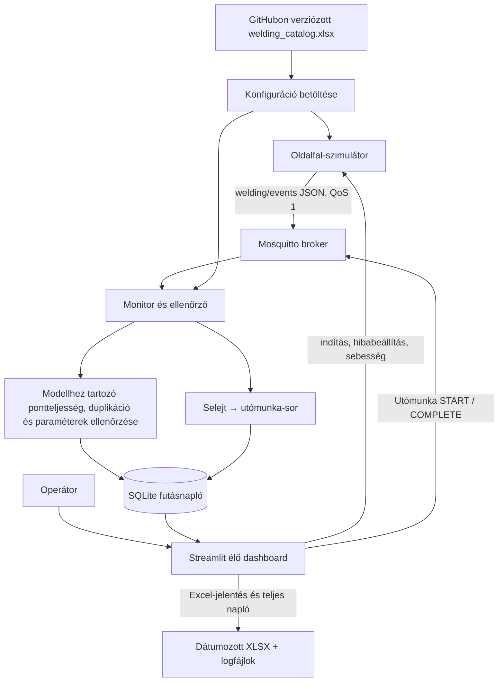
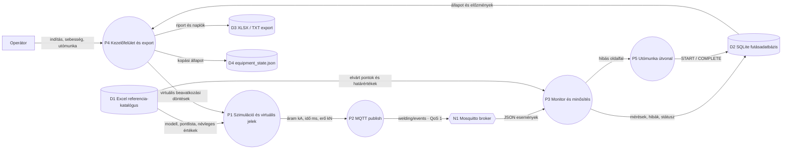

# Rendszerarchitektúra és ellenőrzési terv

## Cél és rendszerhatár

A rendszer tíz járműmodell bal oldalfalának szoftveres ponthegesztési folyamatát szimulálja. A referenciakonfigurációk és a hegesztési pontok a GitHubon verziózott `config/welding_catalog.xlsx` fájlban vannak. A rendszerhatár az Excel-recept betöltésétől az MQTT-adatközvetítésen és ellenőrzésen át a kezelőfelületig és az utómunka-sorba irányításig tart. Valódi gyártási adat, robot vagy hegesztőberendezés nem része a rendszernek.

## Adatforrások és tárolás

- **Excel referencia-katalógus:** járműmodell, alkatrész, konfigurációazonosító, elvárt pontlista, pontmegnevezés, sorrend, névleges paraméterek és modellenkénti határértékek. GitHubon verziózott natív XLSX-munkafüzet, két munkalappal.
- **MQTT:** `welding/events` témán JSON események mennek QoS 1 szinten.
- **SQLite futásnapló:** a fogadott hegesztési értékeket, karosszériafutások állapotát, feldolgozási hibákat és utómunka-eseményeket tárolja. Nem tartalmazza a receptkatalógus forrásadatait.
- **Streamlit:** Excelből beolvasott referenciaadatokat mutat, megjeleníti az aktív futást, a ponttérképet, a méréseket, az előzményeket és az utómunka-sor állapotát.

## CPS-komponensek és szerepek

- **Fizikai folyamat modellje:** egy adott járműmodell bal oldalfalának hegesztési pontjai.
- **Logikai komponensek:** Excel-katalógus betöltő, szimulátor/publisher, MQTT-broker, monitor/ellenőrző, SQLite-adattár és Streamlit dashboard.
- **Transzducer/szenzor szerepének szimulációja:** a szimulátor a kiválasztott Excel-konfiguráció névleges értékei körül áramerősséget, hegesztési időt és elektródaerőt generál.
- **Emberi szerep:** az operátor a gyártás kézi indítása előtt beállítja a pontonkénti hibaarányt és hibamódot, a sebességet 100–10 000% között állíthatja, figyeli a hegesztést, ellenőrzi a hibajelzéseket, kezeli az utómunkát, és kijelentkezéskor Excel-jelentést készíthet. A tíz modell közül a rendszer automatikusan választ.

## Architektúra és adatfolyam



## Konfigurációk és üzenetek

A GitHubon tárolt, két munkalapos Excel-munkafüzet tíz modell–alkatrész konfigurációt tartalmaz: CUPRA Terramar; Audi Q8, Q5, Q3, Q4 e-tron, A6 és A3; Volkswagen Tiguan és ID.4; Škoda Kodiaq. Mindegyik az **Oldalfal (bal)** alkatrészt modellezi, de külön pontazonosítókat, pontszámot, névleges paramétereket és határértékeket használ. Ezek szintetikus oktatási adatok, nem gyártói előírások.

- `body_start`: konfigurációazonosító és karosszériafutás indítása.
- `weld_result`: konfigurációazonosító, pontazonosító, áramerősség, hegesztési idő, elektródaerő és időbélyeg.
- `body_complete`: lezárja az adott oldalfal ellenőrzését. Az elvárt pontlistát a monitor az Excel-katalógusból olvassa, nem a kliens üzenetéből fogadja el igazságforrásként.
- `rework_action`: operátori `START` vagy `COMPLETE` utómunka-művelet megjegyzéssel.

## Ellenőrzés és hibakezelés

1. A kiválasztott Excel-konfiguráció határozza meg az érvényes pontazonosítókat és paraméterhatárokat.
2. Hiányzó, váratlan vagy többször beérkező pontazonosító külön hibaként megjelenik.
3. A három mérési paraméter a kiválasztott modell saját határértékei alapján ellenőrződik.
4. Hibás JSON, ismeretlen eseménytípus, hiányzó azonosító és ismeretlen konfiguráció a `system_errors` naplóba kerül.
5. Nem megfelelő lezárt oldalfal automatikusan `SELEJT / UTÓMUNKÁRA KÜLDVE` állapotot kap, és bekerül a rework queue-ba.
6. Utómunka állapotmenet: `UTÓMUNKÁRA VÁR` → `UTÓMUNKA FOLYAMATBAN` → `UTÓMUNKA ELVÉGEZVE – ÚJRAELLENŐRZÉS SZÜKSÉGES`. Ez az utolsó állapot sem minősíti automatikusan megfelelőre a korábbi selejtes darabot.
7. Az élő gyártási fül 1 másodpercenként, a statisztika fül 2 másodpercenként frissül.

## Üzemeltetési vezérlés és jelentés

- A dashboard induláskor **nem indít automatikusan gyártást**. Az operátor beállíthatja a hibaarányt, a hibamódot és a 100–10 000%-os sebességet, majd külön gombbal indíthat.
- A 100%-os sebesség a 90 ms-os pontküldési alapvárakozást és a 10 másodperces ciklusok közötti szünetet jelenti. A nagyobb sebesség ezeket a várakozásokat csökkenti; nem ígér ugyanekkora tényleges gyorsulást.
- A publisher a QoS 1 üzeneteket sorrendben sorba állítja, miközben a hálózati hurok kezeli a visszaigazolásokat. A ciklus vége előtt a visszaigazolásokat ellenőrzi, összesített időkorláttal. A dashboard a publish után az SQLite-ban megvárja a karosszéria végleges minősítését. Ha a monitor 30 másodperc alatt nem véglegesít, vagy bármelyik ciklus hibára fut, az automatika leállítja az új ciklusok indítását, és hibát ír a naplóba; ezzel megelőzi a feldolgozatlan üzenetek korlátlan felhalmozását. Újraindítás előtt az operátor ellenőrzi az MQTT-brokert, a monitort és a hibanaplót.
- A jobb felső kijelentkezés először dátumozott Excel-pillanatképet ment, és nem vár arra, hogy a gyártási szál magától leálljon. Ha a szál befejeződik, a munkafüzet a legfrissebb mentett adatokkal frissül.
- Az SQLite adatbázis, a ciklusonkénti JSON, a napi JSONL és az alkalmazás/konzolnaplók külön rétegek. A napló- és Excel-export nem helyettesíti a folyamatos SQLite-mentést.

## Tesztterv

| Azonosító | Bemenet | Elvárt eredmény |
|---|---|---|
| T01 | Tíz modellkonfiguráció a katalógusban | Pontlisták és határértékek különállók |
| T02 | Minden szükséges pont megfelelő | MEGFELELŐ; nincs utómunka |
| T03 | Egy pont hiányzik | Selejt; hiányzó pont listázva; automatikus utómunka |
| T04 | Ugyanaz a pont kétszer érkezik | Duplikáció; selejt; automatikus utómunka |
| T05 | Paraméter túllépi a kiválasztott modell határértékét | Paraméterhiba; selejt |
| T06 | Nem katalógusban szereplő pont érkezik | Váratlan pont; selejt |
| T07 | Ismeretlen konfiguráció vagy esemény | Feldolgozási hiba naplózva |
| T08 | Utómunka START, majd COMPLETE | Állapotátmenet és műveleti napló |
| T09 | Sebesség 100% és 10 000% | Alapidők megőrzése és megfelelő skálázás |
| T10 | MQTT-küldés sebességtesztje | Az események sorrendben sorba állnak, QoS 1 visszaigazolások ellenőrzöttek |
| T11 | Excel-jelentés létrehozása | Összes adatlap megvan, az üres adatbázis is kezelhető |
| T12 | Két jelentés ugyanabban a másodpercben | A fájlnevek nem írják felül egymást |
| T13 | A monitor késve véglegesíti a karosszériát | Az automatika vár a DB-státuszra, időtúllépéskor biztonságosan leáll |
| T14 | Túlméretes Excel-adattábla | Több számozott munkalap; minden sor megőrizve |
| T15 | Valódi Mosquitto + monitor + SQLite | Jó ciklus MEGFELELŐ; határérték-hiba selejt/utómunka-sorba kerül |

Futtatás:

```powershell
python -m unittest discover -s tests -v
```

## Korlátok és feltevések

A jármű- és paraméteradatokat oktatási céllal szintetikusan állítottuk elő. Nem szabad tényleges Audi, CUPRA, Volkswagen vagy Škoda gyártási előírásként kezelni őket. A folyamatparaméterek ellenőrzése nem igazolja a fizikai hegesztési kötés minőségét vagy mechanikai szilárdságát. A referencia-konfigurációk forrása az Excel, a DB csak a futás eredményeit és eseményeit rögzíti.

## Virtuális érzékelők és adatforrások

A rendszerben nincs fizikai szenzor. A mérési értékeket a `src/simulator.py` állítja elő a kiválasztott Excel-konfiguráció névleges értékei körüli szimulált variációval. A `src/virtual_sensors.py` minden hegesztési eredményhez csatolja a virtuális csatorna azonosítóját és az adat eredetét. Egy `weld_result` esemény egy mintát jelent egy hegesztési pontnál; a mintavételezés tehát eseményvezérelt, nem állandó Hz-frekvenciájú.

| Virtuális csatorna | Azonosító | Adatmező | Mértékegység | Mintavétel |
|---|---|---|---|---|
| Hegesztőáram mérőmodell | `VS-CURRENT-01` | `current_ka` | kA | 1 eseményminta/hegesztési pont |
| Hegesztési idő időmérőmodell | `VS-TIMER-01` | `weld_time_ms` | ms | 1 eseményminta/hegesztési pont |
| Elektródaerő mérőmodell | `VS-FORCE-01` | `electrode_force_kn` | kN | 1 eseményminta/hegesztési pont |

Az esemény a `signal_origin=SIMULATED_VIRTUAL_SENSOR` mezővel jelzi az eredetet, és a `sensor_sources` mezőben a virtuális csatornaazonosítókat adja meg. A kódban a természetesnek szánt alapvariáció az áramnál ±0,12 kA, a hegesztési időnél ±4 ms, az elektródaerőnél ±0,04 kN; az értékek a katalógus határain belül maradnak, kivéve a külön hibainjektálást vagy a kopásmodell által jelzett esetet. Ezek programozott modellértékek, nem fizikai mérőeszköz pontossági adatai és nem kalibrációs bizonytalanságok.

## Logikai beavatkozási és ember–gép interakciós pontok

| Azonosító | Beavatkozási pont | Kimenet | Fizikai hatás |
|---|---|---|---|
| `LA-PARAM-COMP-01` | Korlátozott paraméterkorrekció | Áram-/hegesztésiidő-érték módosítása a katalógushatárokon belül | Nincs; a következő szimulált jelre hat |
| `LA-REWORK-ROUTE-01` | Utómunka-útvonal logikai kapcsolója | Hibás oldalfal felvétele az SQLite utómunka-sorába | Nincs; adatbázis-állapotváltozás |
| `LA-TOOL-CHANGE-01` | Elektródaegység-csere szimulációja | Kopási állapot nullázása, csereesemény naplózása | Nincs; szimulált karbantartási esemény |

Az operátor a dashboardon indítja és állítja le a gyártást, módosíthatja a sebességet, START/COMPLETE műveletekkel kezeli az utómunkát, illetve riportot exportálhat. A beavatkozási pontok szoftveres/logikai aktuátorok, nem robot-, PLC- vagy hegesztőpisztoly-kimenetek.

## 0. rendű adatfolyamdiagram (DFD Level 0)

Az ábra a rendszer külső szereplőit, fő folyamatait, adattárait és a hálózati szolgáltatást mutatja. A három virtuális érzékelő egyetlen „P1 – mérési adatok előállítása” folyamat részeként jelenik meg; a fizikai folyamaton nincs tényleges mérőmodul.



## Helyi hálózati kapcsolat

Alapértelmezésben a publisher és a monitor `127.0.0.1:1883` címen éri el a Dockerben futó Mosquitto brokert. A kliensvégpont a `src/network_config.py` modulban közös, és környezeti változókból LAN-címre állítható:

```powershell
$env:BODYLINE_MQTT_HOST = "192.168.1.50"
$env:BODYLINE_MQTT_PORT = "1883"
$env:BODYLINE_MQTT_TOPIC = "welding/events"
.\Start_HegesztesSzimulacio.ps1
```

A példában a `192.168.1.50` csak helyőrző; a broker tényleges IP-címét kell megadni. A beállításnak a publisheren és a monitoron is azonosnak kell lennie. A Mosquitto konténer 1883-as portja a Docker host hálózati interfészein publikálódik, így magánhálózaton másik gépről is elérhető lehet, ha a tűzfal engedélyezi.

**Biztonsági korlát:** a jelenlegi Mosquitto-konfiguráció anonim hozzáférést és titkosítatlan MQTT-t használ oktatási laborhoz. A 1883-as portot kizárólag megbízható, elkülönített magánhálózaton szabad használni; internetre továbbítani tilos. Éles környezethez felhasználónév/jelszó, ACL, TLS és hálózati szegmentálás szükséges.

## UML-terv

A tervezési nézeteket PlantUML-források tartalmazzák a `docs/uml/` mappában: használatieset-diagram, telepítési diagram, aktivitásdiagram és munkadarab-állapotgép. Ezek együtt mutatják be a rendszerhatárt, az operátori szerepet, az adatút fő lépéseit, a helyi hálózati szolgáltatást és az utómunka állapotátmeneteit. A UML-rajzok a jelenlegi szoftveres demonstrációt írják le; nem állítanak fizikai érzékelő- vagy aktuátor-hardvert.

## Videóbemutató

A kötelező rendszerbemutató videó felvételéhez a `docs/video_demo_script.md` forgatókönyvet és a `tools/Record-Bodyline-Demo.ps1` FFmpeg segédszkriptet lehet használni. A tényleges MP4-fájlt a működő rendszerről kell felvenni, majd a `docs/demo_video/BODYLINE_demo.mp4` útvonalon a repositoryba feltölteni. A felvételi segéd hozzáadása önmagában nem helyettesíti a videófájlt.
