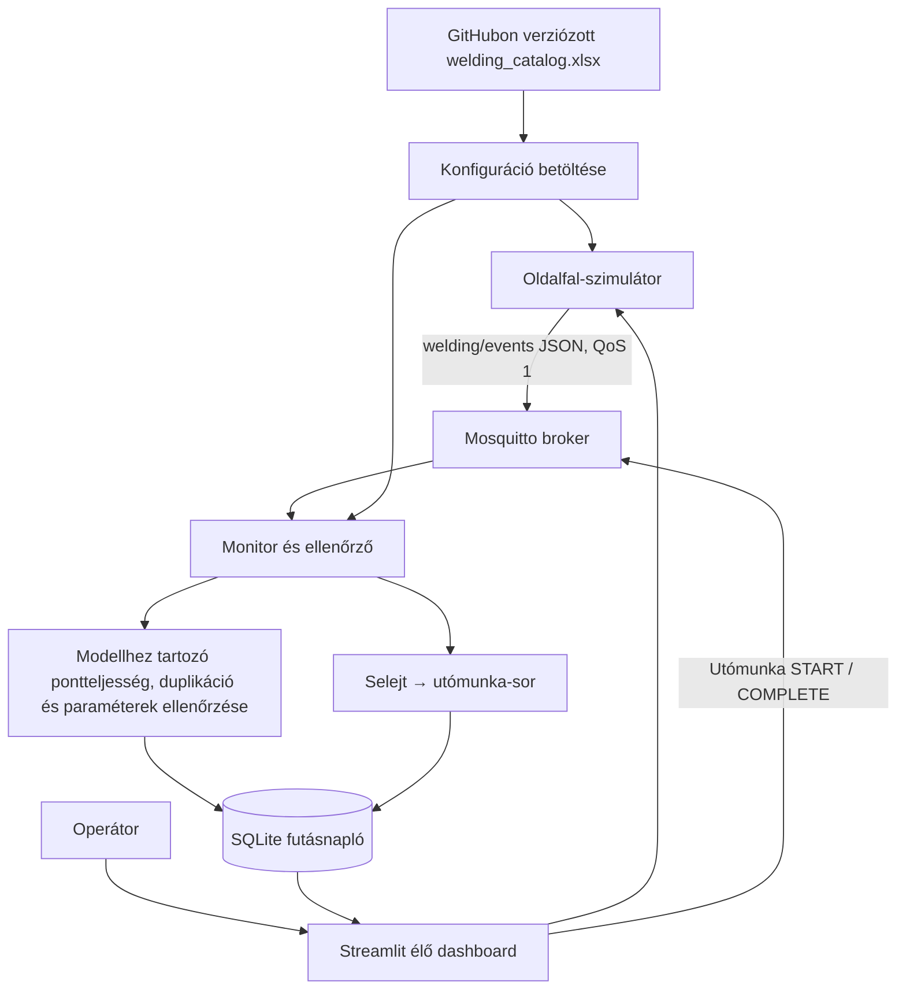

# Rendszerarchitektúra és ellenőrzési terv

## Cél és rendszerhatár

A rendszer tíz járműmodell bal oldalfalának szoftveres ponthegesztési folyamatát szimulálja. A referenciakonfigurációk és a hegesztési pontok a GitHubon verziózott `config/welding_catalog.xml` fájlban vannak. A rendszerhatár az Excel-recept betöltésétől az MQTT-adatközvetítésen és ellenőrzésen át a kezelőfelületig és az utómunka-sorba irányításig tart. Valódi gyártási adat, robot vagy hegesztőberendezés nem része a rendszernek.

## Adatforrások és tárolás

- **Excel referencia-katalógus:** járműmodell, alkatrész, konfigurációazonosító, elvárt pontlista, pontmegnevezés, sorrend, névleges paraméterek és modellenkénti határértékek. GitHubban verziózott, Excelben megnyitható SpreadsheetML XML munkafüzet.
- **MQTT:** `welding/events` témán JSON események mennek QoS 1 szinten.
- **SQLite futásnapló:** a fogadott hegesztési értékeket, karosszériafutások állapotát, feldolgozási hibákat és utómunka-eseményeket tárolja. Nem tartalmazza a receptkatalógus forrásadatait.
- **Streamlit:** Excelből beolvasott referenciaadatokat mutat, megjeleníti az aktív futást, a ponttérképet, a méréseket, az előzményeket és az utómunka-sor állapotát.

## CPS-komponensek és szerepek

- **Fizikai folyamat modellje:** egy adott járműmodell bal oldalfalának hegesztési pontjai.
- **Logikai komponensek:** Excel-katalógus betöltő, szimulátor/publisher, MQTT-broker, monitor/ellenőrző, SQLite-adattár és Streamlit dashboard.
- **Transzducer/szenzor szerepének szimulációja:** a szimulátor a kiválasztott Excel-konfiguráció névleges értékei körül áramerősséget, hegesztési időt és elektródaerőt generál.
- **Emberi szerep:** az operátor kiválasztja a járműmodellt, figyeli a hegesztést, ellenőrzi a hibajelzéseket és követi az utómunka állapotát.

## Architektúra és adatfolyam



## Konfigurációk és üzenetek

Az Excel-kompatibilis, két munkalapos munkafüzet tíz modell–alkatrész konfigurációt tartalmaz: CUPRA Terramar; Audi Q8, Q5, Q3, Q4 e-tron, A6 és A3; Volkswagen Tiguan és ID.4; Škoda Kodiaq. Mindegyik az **Oldalfal (bal)** alkatrészt modellezi, de külön pontazonosítókat, pontszámot, névleges paramétereket és határértékeket használ. Ezek szintetikus oktatási adatok, nem gyártói előírások.

- `body_start`: konfigurációazonosító és karosszériafutás indítása.
- `weld_result`: konfigurációazonosító, pontazonosító, áramerősség, hegesztési idő, elektródaerő és időbélyeg.
- `body_complete`: lezárja az adott oldalfal ellenőrzését. Az elvárt pontlistát a monitor az Excel-katalógusból olvassa, nem a kliens üzenetéből fogadja el igazságforrásként.
- `rework_action`: operátori `START` vagy `COMPLETE` utómunka-művelet megjegyzéssel.

## Ellenőrzés és hibakezelés

1. A kiválasztott Excel-konfiguráció határozza meg az érvényes pontazonosítókat és paraméterhatárokat.
2. Hiányzó, váratlan vagy többször beérkező pontazonosító külön hibaként megjelenik.
3. A három mérési paraméter a kiválasztott modell saját határértékei alapján ellenőrződik.
4. Hibás JSON, ismeretlen eseménytípus, hiányzó azonosító és ismeretlen konfiguráció a `system_errors` naplóba kerül.
5. Nem megfelelő lezárt oldalfal automatikusan `SELEJT / UTÓMUNKÁRA KÜLDVE` állapotot kap, és bekerül a rework queue-ba.
6. Utómunka állapotmenet: `UTÓMUNKÁRA VÁR` → `UTÓMUNKA FOLYAMATBAN` → `UTÓMUNKA ELVÉGEZVE – ÚJRAELLENŐRZÉS SZÜKSÉGES`. Ez az utolsó állapot sem minősíti automatikusan megfelelőre a korábbi selejtes darabot.
7. A dashboard 2 másodpercenként frissül.

## Tesztterv

| Azonosító | Bemenet | Elvárt eredmény |
|---|---|---|
| T01 | Tíz modellkonfiguráció a katalógusban | Pontlisták és határértékek különállók |
| T02 | Minden szükséges pont megfelelő | MEGFELELŐ; nincs utómunka |
| T03 | Egy pont hiányzik | Selejt; hiányzó pont listázva; automatikus utómunka |
| T04 | Ugyanaz a pont kétszer érkezik | Duplikáció; selejt; automatikus utómunka |
| T05 | Paraméter túllépi a kiválasztott modell határértékét | Paraméterhiba; selejt |
| T06 | Nem katalógusban szereplő pont érkezik | Váratlan pont; selejt |
| T07 | Ismeretlen konfiguráció vagy esemény | Feldolgozási hiba naplózva |
| T08 | Utómunka START, majd COMPLETE | Állapotátmenet és műveleti napló |

Futtatás:

```powershell
python -m unittest discover -s tests -v
```

## Korlátok és feltevések

A jármű- és paraméteradatokat oktatási céllal szintetikusan állítottuk elő. Nem szabad tényleges Audi, CUPRA, Volkswagen vagy Škoda gyártási előírásként kezelni őket. A folyamatparaméterek ellenőrzése nem igazolja a fizikai hegesztési kötés minőségét vagy mechanikai szilárdságát. A referencia-konfigurációk forrása az Excel, a DB csak a futás eredményeit és eseményeit rögzíti.
